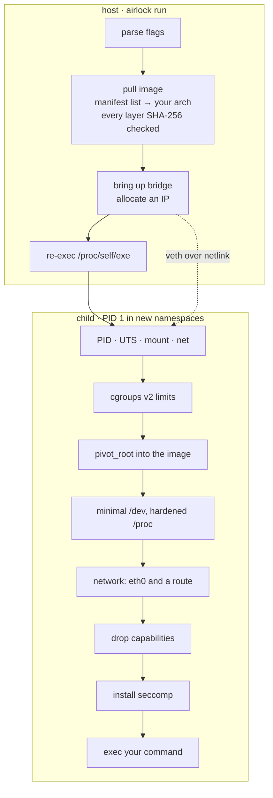

<p align="center">
  
</p>

<p align="center">
  <b>A container is not a small virtual machine. It is a process the kernel has been told to lie to.</b><br>
  <sub>A container runtime built by hand in Go, on the same kernel features Docker uses, to show exactly what those lies are and how each one is told.</sub>
</p>

<p align="center">
  <sub>
    <a href="#overview">OVERVIEW</a> &nbsp;·&nbsp;
    <a href="#quick-start">QUICK START</a> &nbsp;·&nbsp;
    <a href="#how-it-works">HOW IT WORKS</a> &nbsp;·&nbsp;
    <a href="#six-demos">SIX DEMOS</a> &nbsp;·&nbsp;
    <a href="#security-model">SECURITY</a> &nbsp;·&nbsp;
    <a href="#field-notes">FIELD NOTES</a>
  </sub>
</p>

<p align="center">
  <a href="https://github.com/kelyonn/airlock/actions/workflows/ci.yml"></a>
</p>

<table>
  <tr>
    <td><sub>NOT USED</sub><br><b>runc · libcontainer · libseccomp</b></td>
    <td><sub>SECCOMP</sub><br><b>default-deny, 272 allowed</b></td>
    <td><sub>CAPABILITIES KEPT</sub><br><b>14</b></td>
    <td><sub>END-TO-END SUITE</sub><br><b>40 steps</b></td>
  </tr>
</table>

## Overview

Airlock pulls real images from Docker Hub, runs them in their own namespaces with their own network, limits them with cgroups, and locks them down with capabilities and a hand-assembled seccomp filter. It also runs multi-container stacks, with service-name DNS between them.

> [!NOTE]
> This is not a Docker replacement. It is what is underneath one, built to be understood. Do not point it at anything you depend on.

## Quick start

Linux, Go 1.25+, and root.

```bash
go build -o airlock .
sudo ./airlock run alpine:3.20 /bin/sh
sudo ./airlock run -p 8080:80 nginx:alpine
```

On a Mac, use the bundled dev container (`docker build -t airlock-dev .`), which runs Airlock inside a privileged Linux sandbox.

## How it works

What happens when you run `airlock run alpine:3.20 /bin/sh`:



> [!TIP]
> **The host process and the container's PID 1 are the same binary.** Go cannot `fork()` safely (goroutines and the scheduler do not survive it), so Airlock re-executes itself into the new namespaces and takes the child path.

Networking is set up over raw netlink sockets, the same mechanism containerd uses. There are no `ip`, `iptables` or `nsenter` shell-outs on the way up.

## Six demos

In order of how convincing they are.

| | Demo | Command |
|:-:|---|---|
| 1 | Real isolation: its own PID 1, hostname and filesystem | `airlock run --no-seccomp alpine:3.20 sh -c 'echo pid=$$; hostname'` |
| 2 | The real registry protocol, multi-arch, digests verified | `airlock run --no-seccomp nginx:alpine` |
| 3 | Networking with a real port-forward | `airlock run -p 8080:80 nginx:alpine & curl localhost:8080` |
| 4 | Seccomp says no | `airlock run alpine:3.20 sh -c 'mknod /tmp/d c 1 3'` |
| 5 | Multi-container stacks with service DNS | `airlock compose up` |
| 6 | The lifecycle you expect | `airlock exec`, `logs`, `stop`, `ps` |

<details>
<summary><b>The best demo: one process, two points of view</b></summary>
<br>

```bash
airlock run --userns alpine:3.20 sleep 30 &
CID=$(airlock ps | tail -1 | awk '{print $1}')
grep Uid: /proc/"$CID"/status   # an unprivileged host UID, e.g. 165536
airlock exec "$CID" id          # uid=0(root) inside
```

Root inside, nobody outside. That is user namespaces made visible in ten seconds, using Airlock's own UID mapping and per-container range allocation.

</details>

> [!NOTE]
> Demos 1 to 3 pass `--no-seccomp` only because seccomp deadlocks Docker Desktop's single-vCPU VM. It is on by default and shown for real in demo 4, on real Linux.

## Security model

| Layer | What Airlock does |
|---|---|
| **User namespaces** | Opt-in with `--userns`. Container root maps to an unprivileged host UID, and each container gets its own 65,536-wide range. |
| **Capabilities** | Cut to Docker's default fourteen. `CAP_SYS_ADMIN`, `CAP_SYS_MODULE`, `CAP_NET_ADMIN` and `CAP_SYS_PTRACE` are gone. |
| **Seccomp** | A BPF allow-list, default deny. 272 syscalls on amd64, 232 on arm64, adopted from Docker's own profile. |
| **Devices** | `/dev` is a fresh tmpfs with four nodes, never the host's. |
| **Images** | Optional cosign verification with a static key, in both signature formats. |

> [!WARNING]
> Treat Airlock like `chroot` with several extra locks, not as a boundary between two parties that distrust each other.

## Field notes

The features followed documentation. These are the parts that did not, and they are arguably the more interesting half.

<details>
<summary><b>Seccomp deadlocks Docker Desktop</b></summary>
<br>

Installing a filter calls `synchronize_rcu()`, which waits for every CPU to reach a quiescent state. On a one-vCPU VM the only CPU is the one waiting, and the whole VM freezes. Airlock detects linuxkit through `/proc/version` and skips seccomp there with a warning.

</details>

<details>
<summary><b>Port-forwards failed from the same machine, and the first fix was not enough</b></summary>
<br>

Only a `PREROUTING` DNAT rule existed, so local traffic never matched. Adding `OUTPUT` got the packet sent, yet nothing reached the bridge: DNAT only rewrites the destination, so the packet still claimed source `127.0.0.1` on a non-loopback interface. A narrow `MASQUERADE` for `127.0.0.0/8` fixed it, the same hairpin recipe Docker uses.

</details>

<details>
<summary><b>User namespaces needed two separate permission fixes</b></summary>
<br>

`mount()` checks `CAP_SYS_ADMIN` against the namespace that owns the filesystem's superblock, and the rootfs lived on the host's filesystem. Separately, every path component needs search permission, and `~/.airlock` sat under a `0700` home directory.

</details>

<details>
<summary><b>PID 1 drops unhandled signals, and the fix had its own bug</b></summary>
<br>

`--init` adds a tiny init that forwards signals. Its first version registered handlers only after starting the child, and a backgrounded shell job starts with `SIGINT` ignored, an ignore that survives every `execve()`. Found by reading `SigIgn` in `/proc/<pid>/status` mid-hang. After the fix, `kill -INT` went from never terminating to under 100 ms.

</details>

<details>
<summary><b>And more</b></summary>
<br>

Two races under load (colliding veth names, unlocked state files), containers sharing one cached rootfs, an overlay mount leaking into the host namespace, cgroup delegation silently failing in CI, and a cosign format that no longer matches its own documentation.

</details>

## Usage

```bash
airlock run [--memory 256m] [--cpu 75] [-p 8080:80] [--userns] [--init] IMAGE [CMD]
airlock compose up | down
airlock ps
airlock exec CONTAINER sh
airlock logs [-f] CONTAINER
airlock stop CONTAINER
airlock clean [--images | --verify | --all]
```

## Testing

```bash
go test ./... -race -cover
docker build -t airlock-dev .
docker run --rm --privileged airlock-dev bash /app/test_e2e.sh    # the 40-step suite
```

CI runs vet, the race-detected unit tests, `golangci-lint`, a cross-compile matrix, and the full privileged end-to-end suite on every push.

<sub>MIT.</sub>
